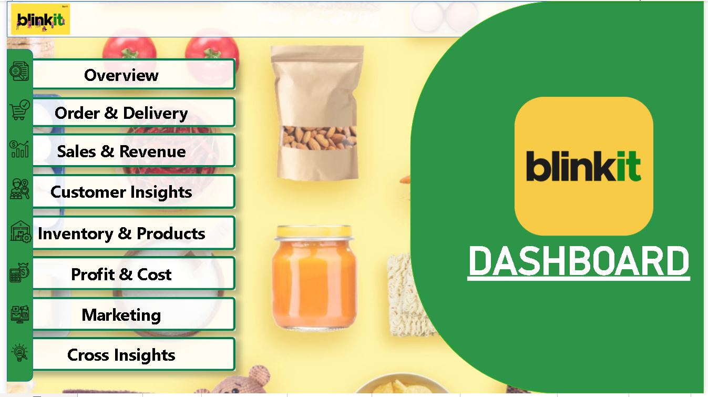
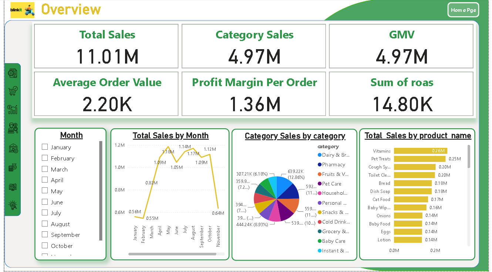
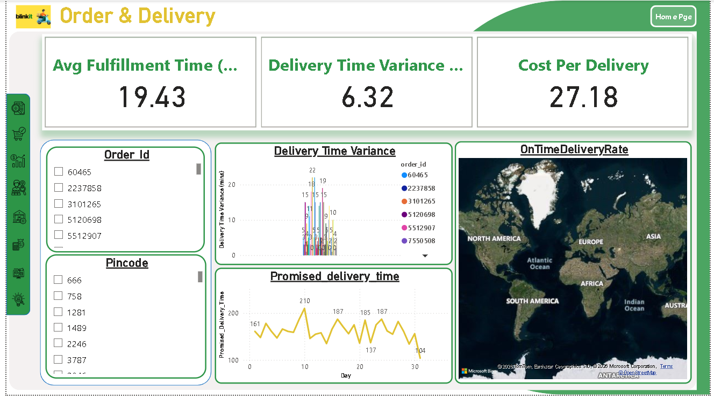
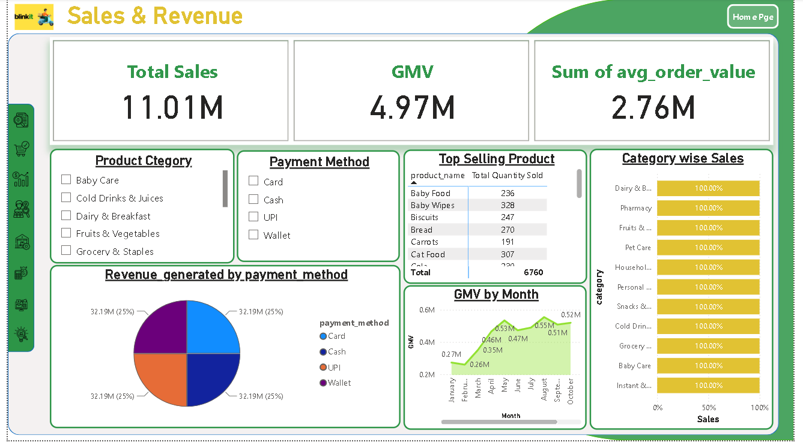
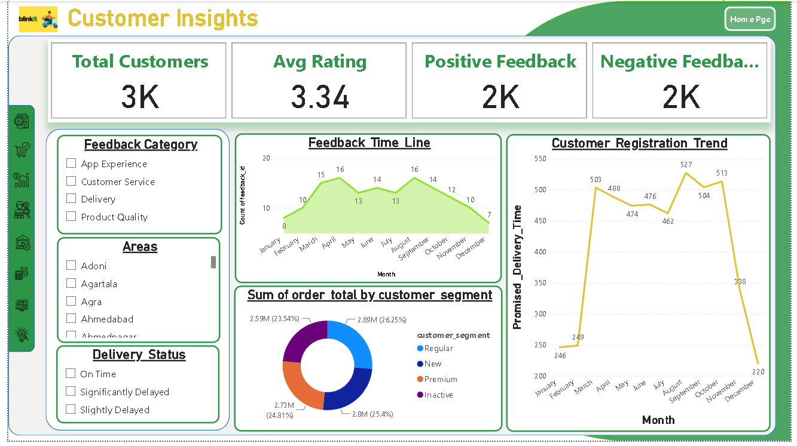
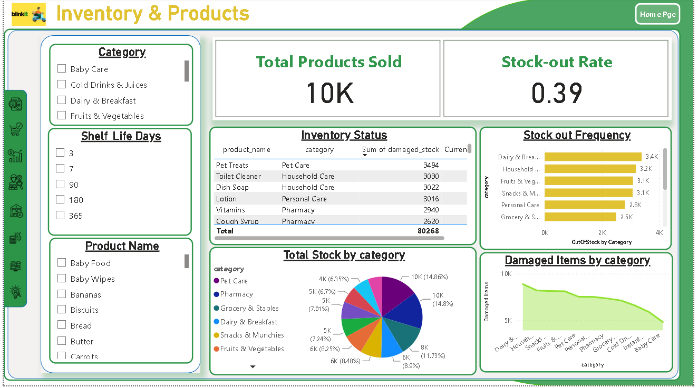
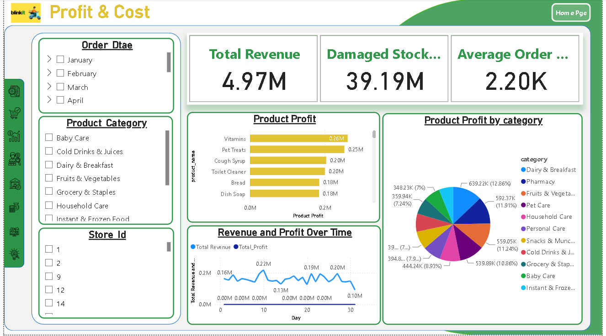
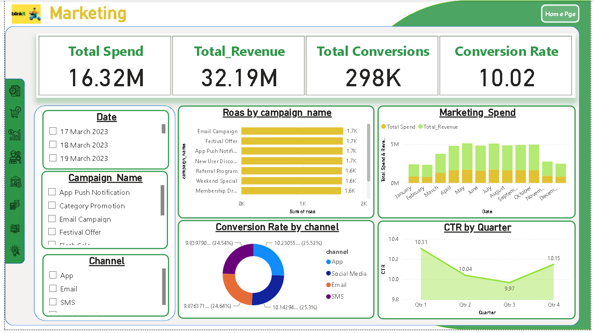
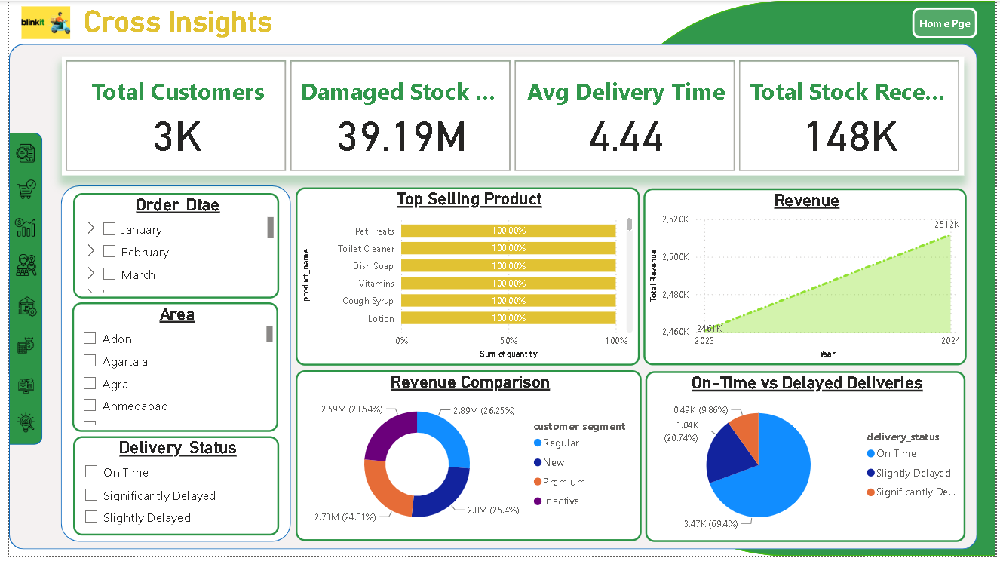

# Blinkit Sales Dashboard

A Power BI dashboard analyzing Blinkit's quick-commerce business performance — covering sales, orders, delivery, customers, inventory, profit, and marketing in one interactive report.

## Overview

This dashboard gives a complete 360° view of a Blinkit-style online grocery business. It tracks how much the business sells, how fast orders reach customers, which products and categories perform best, how customers behave, how inventory is managed, where profit comes from, and how marketing campaigns perform.

## Dashboard Pages

### 1. Home
Navigation hub linking to all dashboard pages: Overview, Order & Delivery, Sales & Revenue, Customer Insights, Inventory & Products, Profit & Cost, Marketing, and Cross Insights.

### 2. Overview
High-level KPIs and trends:
- **Total Sales:** 11.01M | **GMV:** 4.97M | **Average Order Value:** 2.20K
- **Profit Margin Per Order:** 1.36M | **Sum of ROAS:** 14.80K
- Total Sales by Month, Category Sales by Category, and Total Sales by Product Name

### 3. Order & Delivery
Delivery operations performance:
- **Avg Fulfillment Time:** 19.43 | **Delivery Time Variance:** 6.32 | **Cost Per Delivery:** 27.18
- Delivery Time Variance analysis, Promised Delivery Time trend, and On-Time Delivery Rate map

### 4. Sales & Revenue
Revenue breakdown:
- **Total Sales:** 11.01M | **GMV:** 4.97M
- Filters by Product Category and Payment Method (Card, Cash, UPI, Wallet)
- Top Selling Products table, Category-wise Sales, Revenue by Payment Method, and GMV by Month

### 5. Customer Insights
Customer behavior and satisfaction:
- **Total Customers:** 3K | **Avg Rating:** 3.34 | **Positive Feedback:** 2K | **Negative Feedback:** 2K
- Feedback Category and Timeline, Customer Segmentation (Regular, New, Premium, Inactive), and Customer Registration Trend

### 6. Inventory & Products
Stock and product management:
- **Total Products Sold:** 10K | **Stock-out Rate:** 0.39
- Inventory Status table, Stock-out Frequency by Category, Total Stock by Category, and Damaged Items by Category

### 7. Profit & Cost
Profitability analysis:
- **Total Revenue:** 4.97M | **Damaged Stock:** 39.19M | **Average Order:** 2.20K
- Product Profit ranking, Product Profit by Category, and Revenue and Profit Over Time

### 8. Marketing
Campaign and channel performance:
- **Total Spend:** 16.32M | **Total Revenue:** 32.19M | **Total Conversions:** 298K | **Conversion Rate:** 10.02
- ROAS by Campaign Name, Marketing Spend vs Revenue, Conversion Rate by Channel, and CTR by Quarter

### 9. Cross Insights
Combined business view:
- **Total Customers:** 3K | **Damaged Stock:** 39.19M | **Avg Delivery Time:** 4.44 | **Total Stock Received:** 148K
- Top Selling Products, Revenue trend, Revenue Comparison by Customer Segment, and On-Time vs Delayed Deliveries

## Key Features

- 9-page interactive Power BI report with a navigation sidebar
- KPIs for sales, delivery, customers, inventory, profit, and marketing
- Slicers for Month, Category, Product, Payment Method, Area, and Delivery Status
- Cross-page filtering for deep-dive analysis

## Technologies Used

- Power BI
- DAX
- Data Modeling
- Data Visualization

## Project Files

- `Blinkit Dashboard.pbix` — the complete Power BI report file (open in Power BI Desktop)
- `01-home.png` to `09-cross-insights.png` — dashboard page screenshots

## How to View

1. Download the `.pbix` file from this repository
2. Open it in Power BI Desktop (free from Microsoft)
3. Use the sidebar to navigate between the 9 pages

